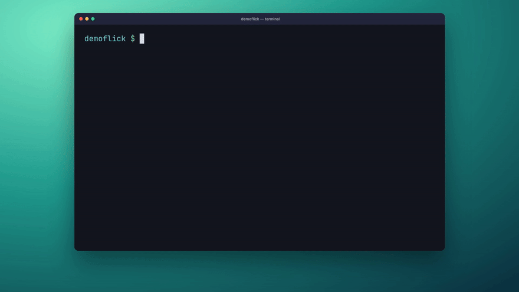

# demoflick

**Ask your coding agent for a demo video. Get one that looks edited.**

demoflick is an agent skill that records your real web app, or your
command-line tool, and renders a finished demo: smooth cursor, automatic zoom
on every action, captions, and a clean window frame. One run gives you three
files.


*This GIF was made by demoflick from [`examples/storyboard.json`](examples/storyboard.json). Nothing was edited by hand.*

| File | Size | Use it for |
|---|---|---|
| `demo.gif` | 880 px wide | Your README |
| `demo.mp4` | 1920 × 1080 | X, LinkedIn, YouTube |
| `demo-vertical.mp4` | 1080 × 1920 | Instagram Reels, Shorts, TikTok |

It records terminals too. Commands are run for real, and long waits are cut:



*Made from [`examples/terminal.json`](examples/terminal.json).*

## Use it

In Claude Code:

```
/plugin marketplace add hpkhariprasad/demoflick
/plugin install demoflick@demoflick
```

Then ask:

> Record a demo of the sign-up flow for my README.

The agent starts your app, finds the flow, writes a storyboard, records it,
checks the result and hands you the files.

For other agents that support the Agent Skills format (Codex, Cursor, Gemini
CLI), copy `skills/demoflick` into the agent's skills folder.

## Use it without an agent

You need Node 18+, ffmpeg and Playwright.

```bash
git clone https://github.com/hpkhariprasad/demoflick
cd demoflick/skills/demoflick
npm install && npx playwright install chromium

node scripts/record.mjs ../../examples/storyboard.json --out demoflick-out
node scripts/render.mjs demoflick-out
```

## How it works

1. **Storyboard.** A short JSON file lists the steps: click this, type that,
   show this caption.
2. **Record.** Playwright drives the real app in headless Chromium. It captures
   frames at 2x resolution and logs the cursor path and every click. No cursor
   is drawn yet.
3. **Render.** Each output frame is composed in a browser: the captured frame,
   a camera that eases in on each action, the cursor, click ripples and
   captions. ffmpeg encodes the result.

Because the cursor and camera are added at render time, the same recording
renders to landscape and vertical without recording twice.

## Storyboard

```json
{
  "title": "Tidy: tasks, done fast",
  "url": "http://localhost:3000",
  "steps": [
    { "action": "type", "selector": "#new", "text": "Record a demo", "caption": "Add a task in seconds" },
    { "action": "click", "selector": "#add" },
    { "action": "click", "selector": "#theme", "caption": "Dark mode, one click" }
  ]
}
```

Actions: `goto`, `click`, `type`, `press`, `hover`, `scroll`, `wait`, and `run`
for terminal commands. Every
step takes an optional `caption`, `zoom` and `pause`. A `setup` list runs
before recording starts, for sign-in and seeding data. The full reference is
in [`skills/demoflick/SKILL.md`](skills/demoflick/SKILL.md).

## Themes

```bash
node scripts/render.mjs demoflick-out --theme sunset
```

`aurora` (default), `sunset`, `mint`, `slate`.

## Limits

- Web apps and command-line tools only. It does not record desktop apps,
  native mobile apps, or full-screen terminal programs such as editors.
  Mobile web works: set a phone-sized `viewport`.
- No voice-over or music.
- Pages with heavy animation need `"scale": 1` in the storyboard to stay smooth;
  the recorder tells you when.
- The vertical format crops a landscape page, so wide layouts lose their edges.
  A narrower `viewport` in the storyboard helps.

## Licence

MIT
