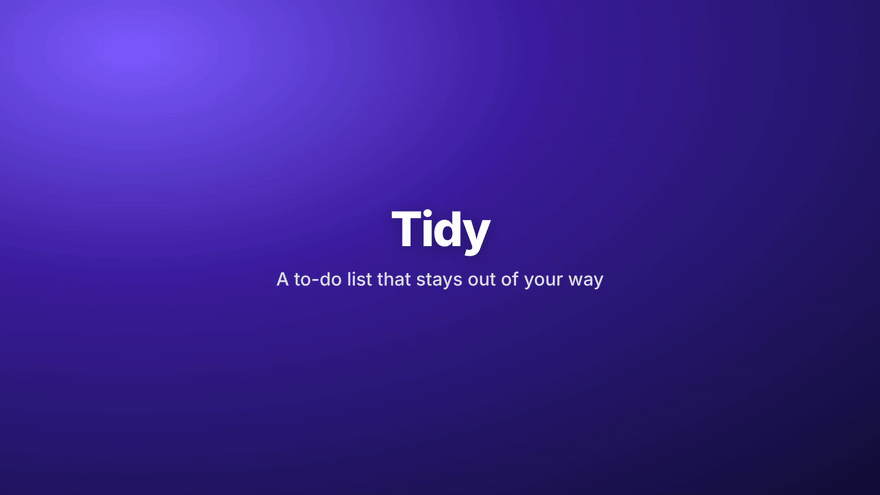

# demoflick

**Ask your coding agent for a demo video. Get one that looks edited.**

demoflick is an agent skill that records your real web app, or your
command-line tool, and renders a finished demo: smooth cursor, automatic zoom
on every action, captions, title cards and a clean window frame. One recording
renders to every format you need.



*This GIF was made by demoflick from [`examples/storyboard.json`](examples/storyboard.json). Nothing was edited by hand.*

| File | Size | Use it for |
|---|---|---|
| `demo.gif` | 880 px wide | Your README |
| `demo.mp4` | 1920 × 1080 | X, LinkedIn, YouTube |
| `demo-vertical.mp4` | 1080 × 1920 | Instagram Reels, Shorts, TikTok |
| `demo-square.mp4` | 1080 × 1080 | Instagram and LinkedIn feed posts |

It records terminals too. Commands are run for real, and long waits are cut:


*Made from [`examples/terminal.json`](examples/terminal.json).*

## Use it

In Claude Code:

```
/plugin marketplace add hpkhariprasad/demoflick
/plugin install demoflick@demoflick
```

Then ask:

> Record a demo of the sign-up flow for my README.

The agent starts your app, finds the flow, writes a storyboard, records it,
checks the result and hands you the files.

The first run installs Playwright and a Chromium browser (about 150 MB) into
`~/.cache/demoflick`. You need Node 18 or later. ffmpeg is used if you have it;
otherwise a bundled copy is downloaded.

For other agents that support the Agent Skills format (Codex, Cursor, Gemini
CLI), copy `skills/demoflick` into the agent's skills folder.

## Features

- **Real app, real clicks.** Playwright drives your running app; nothing is
  mocked up.
- **Edited look.** Smooth cursor, zoom on every action, click ripples,
  captions, keyboard shortcuts shown on screen, intro and outro title cards.
- **Terminal demos.** Commands run for real with colours, and long waits are
  cut.
- **Private data stays private.** Blur any element with `redact`, mask secrets
  in terminal output, and pass passwords as `${env:NAME}` instead of writing
  them into the storyboard.
- **Signed-in apps.** Sign in during setup, or save a session once and reuse
  it.
- **Always up to date.** A GitHub Action re-records your README demo when the
  app changes.
- **Works on Linux, macOS and Windows.** Tested on all three in CI.

## Use it without an agent

You need Node 18 or later.

```bash
git clone https://github.com/hpkhariprasad/demoflick
cd demoflick
node skills/demoflick/scripts/setup.mjs   # once

node skills/demoflick/scripts/record.mjs examples/storyboard.json
node skills/demoflick/scripts/render.mjs
```

The videos land in `demoflick-out/`.

## Keep it up to date

The repository is also a GitHub Action. This workflow starts your app,
records the storyboard and commits a new `assets/demo.gif` when the app
changes:

```yaml
name: Update demo
on:
  push:
    branches: [main]
    paths: ['src/**', 'demo/**']   # only what changes the demo
  workflow_dispatch:
permissions:
  contents: write
jobs:
  demo:
    runs-on: ubuntu-latest
    steps:
      - uses: actions/checkout@v4
      - uses: actions/setup-node@v4
        with:
          node-version: 20
      - run: npm ci
      - uses: hpkhariprasad/demoflick@main
        with:
          storyboard: demo/storyboard.json
          start: npm run dev
          wait-for: http://localhost:3000
          gif-path: assets/demo.gif
          commit: 'true'
        env:
          DEMO_PASSWORD: ${{ secrets.DEMO_PASSWORD }}
```

Inputs: `storyboard` (required), `start`, `wait-for`, `wait-timeout`,
`formats` (default `gif`), `theme`, `output`, `gif-path` and `commit`. See
[`action.yml`](action.yml).

## How it works

1. **Storyboard.** A short JSON file lists the steps: click this, type that,
   show this caption.
2. **Record.** Playwright drives the real app in headless Chromium. It captures
   frames at 2x resolution and logs the cursor path and every click. No cursor
   is drawn yet.
3. **Render.** Each output frame is composed in a browser: the captured frame,
   a camera that eases in on each action, the cursor, click ripples and
   captions. Several pages render in parallel, and ffmpeg encodes the result.

Because the cursor and camera are added at render time, the same recording
renders to every format without recording twice.

## Storyboard

```json
{
  "title": "Tidy: tasks, done fast",
  "url": "http://localhost:3000",
  "steps": [
    { "action": "type", "selector": "#new", "text": "Record a demo", "caption": "Add a task in seconds" },
    { "action": "click", "selector": "#add" },
    { "action": "click", "selector": "#theme", "caption": "Dark mode, one click" }
  ]
}
```

Actions: `goto`, `click`, `type`, `press`, `hover`, `scroll`, `wait`, and `run`
for terminal commands. Every step takes an optional `caption`, `zoom` and
`pause`. A `setup` list runs before recording starts, for sign-in and seeding
data. Top-level `intro`, `outro`, `redact`, `session` and `saveSession` add
title cards, blurring and sign-in. The full reference is in
[`skills/demoflick/SKILL.md`](skills/demoflick/SKILL.md).

## Themes

```bash
node skills/demoflick/scripts/render.mjs demoflick-out --theme sunset --formats square,gif
```

`aurora` (default), `sunset`, `mint`, `slate`.

## Limits

- Web apps and command-line tools only. It does not record desktop apps,
  native mobile apps, or full-screen terminal programs such as editors.
  Mobile web works: set a phone-sized `viewport`.
- No voice-over or music.
- On Windows, terminal commands run through `cmd`, and some tools drop their
  colours there.
- Pages with heavy animation need `"scale": 1` in the storyboard to stay smooth;
  the recorder tells you when.
- The vertical format crops a landscape page, so wide layouts lose their edges.
  A narrower `viewport` in the storyboard helps.

## Licence

MIT
